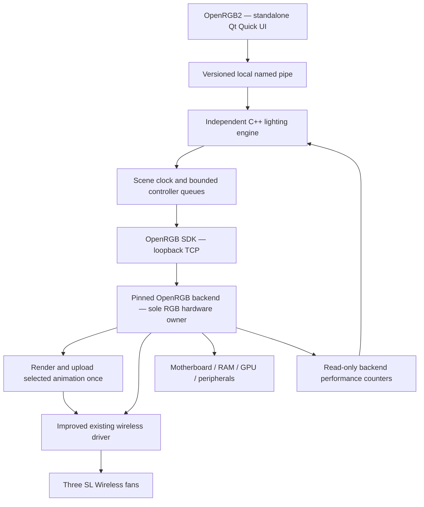

# OpenRGB2 Implementation Plan

> For implementation: use the `superpowers:executing-plans` workflow, execute the milestones in order, and verify each deliverable before advancing. This document describes future work; the current request is planning only.

**Goal:** Build a polished Windows RGB application with smooth uploaded animations and a separate live-effects mode for Daniel's three Lian Li SL Wireless fans, synchronized with his other RGB devices.

**Architecture:** A new standalone Qt Quick UI controls an independent C++ lighting engine. Daniel's wireless-enabled OpenRGB fork runs in the background and owns all RGB hardware. Incorporate relevant protocol improvements from Lian Li Linux into the existing Windows driver.

**Stack:** Windows 11 x64, C++17, Qt 6.8.3/QML, MSVC 2022, CMake for the new application, the existing OpenRGB backend build recipe, TCP SDK for lighting, and restricted local named pipes for application IPC.

**Spec:** Sections 1–6 define the requirements and design; section 7 is the implementation sequence.

**Updated:** 2026-09-26. No hardware actions, builds, or FPS measurements were performed while revising this plan.

## 1. Fixed scope and decisions

| Area | Decision |
| --- | --- |
| Platform | Windows only for the first release. |
| Controls | RGB only. No fan curves, PWM, pump-speed control, temperature control, or LCD video. Preserve the existing cooling setup. |
| OpenRGB | Required background dependency for this release. Use the existing wireless-enabled fork, not stock OpenRGB. |
| UI | A new standalone application. Neither the OpenRGB window nor the old Studio plugin must remain open. |
| Reuse | Keep the working Windows wireless driver and reuse the existing C++ scene/effects, identity, calibration, and lifecycle code. |
| Lian Li Linux | Pinned protocol reference and source of selected improvements; do not port its Linux daemon wholesale. |
| Playback options | Add **Animation playback** for supported repeating effects and **Live effects** for reactive/custom scenes. Persist the selection per scene; apply one mode to the complete wireless group. |
| Priority | Qualify uploaded playback first, then improve and measure live delivery; complete both investigations before the full UI. |
| Publication | Prepare reproducible source and packaging. Publishing remains a separate user decision. |
| Workspace | Implement here; preserve the earlier `openrgb-unified` working tree. |

The user requested L-Connect-style uploaded playback as an option. Target **60 displayed animation frames/s** for that mode and retain **60 live RGB updates/s** as a separate engineering target. Measure and report each independently. The user has not specified a mandatory numerical minimum or accepted a lower live ceiling; uploaded playback does not settle that pending release decision. A missed live target must not block completing the uploaded-playback option, and must not be described as a successful live result.

The first plan's Linux support, cooling/LCD features, separate Rust protocol port, Tauri rewrite, and eventual removal of OpenRGB are excluded from this release. The C++/Qt choice follows inspection of substantial existing code; it avoids another port while allowing a completely redesigned interface.

## 2. Hardware and reusable implementation

### 2.1 Initial hardware profile

These mappings come from the Obsidian notes and dated calibration history. Revalidate the current wiring, identity, firmware, and visible output in Milestone 1. Historical verification is not a measurement from this planning session. [L1–L3]

| Device / connection | Mapping | Required treatment |
| --- | --- | --- |
| Three white Lian Li UNI SL Wireless 120 mm reverse fans | One SL V3 group; three 40-LED zones, 120 logical LEDs total | Primary playback and live-FPS target |
| V1 wireless TX/RX | `0416:8040` and `0416:8041` | Reuse the Windows libusb transport |
| X870E AORUS ELITE WiFi7 ICE, `ARGB_V2_1` | Four mirrored case fans, 8 addressable LEDs total | Four linked visual copies sharing 8 colors |
| Same board, `ARGB_V2_2` | GAMING 360 ICE AIO: indices 0–7 feed three mirrored radiator fans; 8–15 feed pump RGB | 16 LEDs; separate radiator and pump-lighting regions |
| Same board, `ARGB_V2_3` | Top-GPU fan, 8 LEDs | One 8-LED region |
| Corsair Vengeance RGB DDR5, two DIMMs | 10 LEDs each | Resolve separately by stable identity/location |
| AORUS RTX 5080 MASTER ICE | Side logo previously verified; fan-ring behavior at zero RPM unresolved | Include verified output; never change fan speed to enable lighting |
| Razer Basilisk V3 Pro | Wheel, logo, strip | Include supported zones after resolving Synapse ownership |
| Logitech G512 | 107 per-key LEDs | Include mapped keys; exclude the non-visible Extras zone |
| Motherboard `LED_C` / `Chipset Accent` | Physical location not verified | Leave unmapped until identified |

Configure motherboard headers as **8 / 16 / 8**. Do not multiply addressable LED counts by mirrored fan counts. The previous setup initially exposed these headers with zero LEDs.

FanControl remains the cooling owner. The notes record a PawnIO failure affecting both RAM RGB and FanControl sensors; automatic driver resets are not a routine RGB recovery strategy. [L2, L4]

### 2.2 Existing code is the implementation foundation

The vault led to `C:\Users\daniel\tools\openrgb-unified`, which already contains a Windows wireless controller, RF discovery/convergence, compression, a deterministic Qt-free effects engine, device binding, QML calibration, reactive inputs, and display-power handling.

| Inspected source | Revision/state |
| --- | --- |
| Local parent project | `386ad374d44770365bf90c4f1fb08c2522e3a4b6`; tracked changes and untracked work present |
| Local OpenRGB submodule | `53a477eab8d14b0bc49aeb40e3d569cbcb16a377`, branch `lianli-wireless`; modified driver and untracked effects files present |
| Lian Li Linux reference | `ebcf68ef02a39463e8295bb40ce3c5751622c496` |
| Stock OpenRGB reference inspected previously | `0f8f2dccc46576f0a9dac6b70adcbf49901c6b73` |

**The local commit IDs are not complete snapshots.** Import relevant working-tree changes and untracked files with a provenance/hash manifest. Cloning only HEAD would omit inspected functionality. Do not reset, clean, or overwrite the old project.

The existing driver already has `SetFrames`, compression, and uploaded **Spectrum Cycle**, **Rainbow Wave**, and **Breathing** modes. These are the first Animation playback presets. Source support is verified; smoothness and synchronization on this setup remain unmeasured. [L13]

## 3. Wireless performance work

### 3.1 The actual local bottlenecks

The inspected local working tree has the following behavior. [L5–L8]

| Stage | Current behavior | Consequence |
| --- | --- | --- |
| Studio output adapter | 40 ms minimum wireless pacing | At most approximately 25 submissions/s before other costs |
| Wireless runtime | Default `stream_ms = 25`, a 25 ms minimum gap | Ideal admission ceiling of 40 uploads/s with this configuration |
| RGB upload | Header transmitted twice | Extra RF/USB work for each frame |
| USB sender | Four chunks, 1 ms sleep after each, then 2 ms after the RF packet | At least 6 ms of configured sleeps per RF packet |
| Service worker | Default 50 ms wait, interrupted by new desired-state notifications | Not a fixed 20 FPS cap; measure wake behavior |
| Service locking | Runtime ticks hold the mutex also needed by submission | USB/discovery work can delay producers |
| Discovery during live input | New desired frames postpone polling after a sighting | Test bounded route freshness and recovery during continuous streaming |

For `n = ceil(compressed_frame_bytes / 220)` payload packets:

```text
T_sleep = 6 ms × (2 repeated headers + n payload packets)
n = 1: 18 ms, before USB/scheduler/heartbeat overhead
n = 2: 24 ms, before that overhead
```

This is source-derived timing, not measured hardware throughput. Achieving 60 live FPS requires qualifying a faster transport path; a faster UI timer cannot solve it.

The previous plan's approximately 80 ms calculation describes the **upstream Rust uploader**, with four header transmissions and additional delays. It does not describe this local C++ sender. Keep those implementations distinct. [U1]

### 3.2 Measurement contract

Use identical before/after workloads:

1. Moving gradient and rotating band across all 120 wireless LEDs.
2. Repeatable high-entropy per-LED colors to expose compression-dependent limits.
3. Both workloads with the motherboard headers, DIMMs, GPU logo, keyboard, and mouse active.

Record render/submission/queue-replacement counts, lock wait, compression time and bytes, USB duration, heartbeat gaps, discovery age, retries, resets, and p50/p95/p99 visible frame intervals.

Measure presentation using a coded pattern and a suitable high-speed camera or photodiode. Record measurement resolution and LED PWM aliasing limitations. SDK success, USB completion, and an effect-ID match do not prove every frame was displayed. If physical measurement is unavailable, presentation FPS remains unknown.

Sweep qualified producer rates of 10, 20, 30, 40, and 60 FPS. Keep one pending live frame per group. A new frame replaces an unsent older one.

### 3.3 Optimization order

- Instrument the current path first.
- Move scene evaluation out of the UI thread.
- Schedule from monotonic deadlines and measured operation cost; transmission time is part of the period.
- Separate pending-frame exchange from blocking I/O while preserving one serialized TX/RX owner.
- Keep complete RF transactions, validated device identity, and fresh channel/receiver information.
- Preserve the runtime's initial 750 ms heartbeat policy and establish a bounded discovery freshness policy. Continuous updates must not defer identity checks forever.
- Qualify chunk pacing and header repetition changes individually against physical reliability; do not blanket-remove delays.
- Keep reliable static-state convergence separate from replaceable live frames.
- Test repeated colors, effect-ID reuse/wrap, process restart, lost sightings, partial transfers, and changed transmitter identity.

Uploaded animations remain a distinct mode. Smooth autonomous loops cannot substitute for the live-frame performance result.

### 3.4 Animation playback option

**User flow:** Select a supported repeating preset, choose **Animation playback**, adjust its supported color/speed/direction controls, and apply. Generate a complete loop, compress it, upload it, and let the wireless firmware repeat it. Keep the backend running for maintenance and synchronization; closing the UI does not interrupt playback. This follows the uploaded-animation mechanism documented by Lian Li Linux. [U3]

First-release rules:

- Support Spectrum Cycle, Rainbow Wave, and Breathing through the existing OpenRGB modes. Default new instances of these presets to Animation playback. Preserve existing profiles as Live effects during migration; do not silently change their behavior.
- Scope the selection to the whole three-fan wireless group. Other devices receive sampled frames from the matching effect and timeline. Do not stream RGB frames to the wireless group while its uploaded loop owns the lights.
- Keep arbitrary layered scenes, audio reactions, screen mirroring, and key reactions in Live effects. Disable Animation playback for those scenes with a short explanation. Do not buffer unpredictable input into a delayed loop or silently substitute modes.
- Compile again only after an applied parameter change or required recovery. Coalesce edits; retain one pending upload plus in-flight work. After convergence, normal playback sends maintenance/clock traffic, not recurring full-animation uploads.
- Use one shared, deterministic implementation of the three preset renderers and timing calculation in backend and engine. Reuse the existing pure renderer code; map its canonical colors to the calibrated layout for each endpoint.

**Smoothness requires a timing change.** The local modes currently use 48 frames and `interval_ms = max(1, 5000 / speed)`, with speed 10–200. That requests 2–40 playback frames/s, including 20 at the default speed of 100; these are code-derived rates, not physical measurements. Simply exposing the existing modes would not meet a 60 FPS target. [L13]

Preserve the full-cycle duration represented by that speed setting, then generate approximately `round(cycle_seconds * 60)` frames. Replace the integer-millisecond-only `SetFrames` boundary with validated protocol timing, including hundredths of the 0.625 ms tick. Quantize once and use the resulting effective duration on every endpoint. Validate compressed size against 12,288 bytes and frame count against 4,096. If the loop does not fit, reduce frame count while preserving duration and show its lower nominal playback rate; never change effect speed silently. Measure visible playback separately from the configured rate. [L13, U1]

**Mixed-device synchronization:** Port and validate the upstream master-clock read for the V1 transmitter. Sample it through the existing serialized backend worker and expose timestamped snapshots, uncertainty, effective loop timing, and effect identity through read-only diagnostics. Qualify the actual firmware relationship between that clock and the loop's current frame; do not assume the upload-completion time is frame zero. The engine then samples the matching effect phase for other devices, with measured latency compensation and drift correction. Stale/invalid clock data marks synchronization unavailable rather than reporting a false lock. [U3]

**Lifecycle:** Serialize mode changes in the backend, invalidate old pending work, and prevent a queued live frame from overwriting a newly uploaded loop. Returning to Live effects must start with a freshly evaluated complete-group frame. Pause holds a sampled frame; Stop replaces playback with black. On display-off, freeze the wireless loop once, then retain only required maintenance; on wake, revalidate and restore the selected scene. Suspend/disconnect recovery revalidates identity before restoring playback. Do not promise that a loop stops if power/communication disappears before a replacement reaches the device.

## 4. Architecture and interfaces



### Process ownership

- UI and engine are separate processes. Closing the UI keeps playback running. Quit All shuts down owned processes in order.
- Only OpenRGB opens RGB hardware. UI/engine code must not access USB/HID/SMBus directly.
- Preserve the backend's Windows elevation requirements for PawnIO devices. Ordinary UI editing runs at standard-user privilege.
- Use a private backend configuration and SDK port **6744**, bound to `127.0.0.1`. The existing installation used 6742.
- Launch the selected backend with `--server --server-host 127.0.0.1 --server-port 6744 --noautoconnect --localconfig`, with the private configuration directory as its working directory.
- Test the fork's single-instance policy. A separate port prevents accidental client attachment; it does not make duplicate hardware owners valid.
- Detect competing OpenRGB/L-Connect/GCC/Synapse/Logitech lighting owners. Provide an explicit takeover operation; do not kill arbitrary matching processes.
- Disable the old Studio/Effects/HardwareSync scene producers in the managed configuration. The new engine is the sole scene writer.

### Engine and SDK

Extract the existing `studio::EffectEngine::Evaluate(doc, t, frame, input)` and scene/binding types into a shared C++ library. Preserve their deterministic, hardware-independent behavior and regression tests. [L9]

Replace the plugin's in-process controller access with an SDK adapter. Negotiate the version and initially cap the client at **4** for enumeration, mode selection/parameters, resize, and color updates. The inspected fork advertises 6; verify its protocol-4 wire behavior. Resolve supported modes from enumeration rather than hard-coding array indices. [L10]

Use SDK mode updates to select the three uploaded presets and SDK direct-mode color updates for live output. First-release animation playback does not require sending arbitrary animation blobs over the SDK or adding a command pipe. Keep preset generation in the backend; share the pure preset/timing implementation with the engine for matching wired output. Export active preset parameters, effective frame count/interval, upload state, and validated clock snapshots through the existing planned read-only diagnostics pipe.

Submit one complete-controller update for the three wireless fan zones. Three zone edits must not cause three full-group RF uploads. Preserve unmapped colors when assembling a complete controller frame.

Define:

- `DeviceKey`: stable identity plus serial/location disambiguation and zone identity.
- `DeviceSnapshot`: topology generation, LED counts, modes, and connection state.
- `RgbFrame`: controller key, topology generation, sequence, monotonic sample time, canonical RGB colors.
- `DeliveryStats`: submitted/replaced/transport-completed counts, intervals, measurement provenance.
- `PlaybackMode`: `LiveEffects` or `AnimationPlayback`, persisted per scene and validated against preset capabilities.
- `PlaybackStatus`: selected mode, preset/parameter revision, upload state, effective frame count/interval, clock sample and uncertainty, synchronization health, separately recorded physical playback measurements.
- `submitLatest(RgbFrame) -> SubmitResult`: accepted, replaced-pending, or rejected with reason; never “displayed.”

Use a 60 Hz scene clock and independently qualified controller budgets for live output. In Animation playback, align the matching wired-effect timeline to the validated wireless clock. Late work samples current scene time, rather than replaying an obsolete FIFO. A slow wireless group must not stall fast wired devices.

Add a restricted read-only backend diagnostics pipe for aggregate counters. Bound and version messages; restrict access to the intended local user/backend account. Do not turn it into another hardware-command path. SDK packets do not carry all internal sequence metadata, so correlate benchmark patterns/counters explicitly.

Cross-device output samples a common scene timeline. Add latency compensation only after measurement. Do not claim atomic multi-device presentation from sequential SDK writes. Keep UI status pending until the backend reports the applied mode/parameter revision; SDK transmission success is not hardware confirmation.

## 5. New UI specification

| View | Required functionality |
| --- | --- |
| Dashboard | Lighting preview, current scene, brightness, playback, connected-device health, wireless performance status |
| Lighting | Preset cards, palette, supported speed/color/direction controls, group selection, **Animation playback / Live effects** selector, audio/screen/key-reactive controls |
| Layout | Case/desk arrangement, linked mirrored fans, orientation, LED identification/calibration, undo/redo |
| Devices & Diagnostics | Mapping, ownership conflicts, firmware when available, measured delivery rates, replacement/retry counts, reconnect state, diagnostic export |

Use neutral dark surfaces, an ICE/white accent, clear typography, generous spacing, keyboard access, and restrained animation. Create shared design tokens and reusable QML components.

The main flow is **choose scene → select devices → adjust color/speed → save**. Keep calibration and protocol details outside ordinary scene editing.

Place the playback selector beside the selected effect. Explain Animation playback as “Smooth repeating effects played by the fans” and Live effects as “Responds to music, screen, and live changes.” Show Uploading, Active, Reconnecting, or Failed as applicable. Distinguish configured playback rate, measured physical playback rate, live delivery rate, and preview FPS in Diagnostics. Report an unknown measurement as unknown. Expose only controls the selected uploaded preset supports; arbitrary palettes/layers remain live-only in this release.

Reuse the spatial model and useful 3D preview code, but ordinary lighting controls must work without navigating a 3D editor. Preview and output use the same sampled colors/brightness; preview FPS is labelled separately.

The existing calibration report recorded acceptance of an out-of-range LED address and Save ignoring uncommitted text. Add regression coverage at UI, core, and persistence boundaries even if the imported code appears to fix them. [L11]

## 6. Constraints and acceptance criteria

### Global constraints

- Apply the 120-LED wireless and 8/16/8 motherboard layouts correctly.
- Preserve FanControl, sensors, PWM, pump speed, and GPU fan settings. Maintain required wireless heartbeat traffic.
- Preserve missing-device profiles; resolve identities again after reconnect rather than saving enumeration indices.
- Stop obsolete frames on topology change, disconnect, suspend, and display-off.
- Enforce a single live-or-uploaded RGB producer per wireless group; maintain the selected playback mode and effective preset across UI restart.
- Preserve display-power behavior: pause RGB frame output and reactive capture while displays are off; keep only device-required maintenance. GPU RGB traffic must not repeatedly wake the monitor. [L12]
- Avoid automatic binding, firmware commands, PawnIO resets, USB-driver replacement, or security-setting changes.
- Bound queues, retry/backoff, messages, memory, shutdown time, and logs.
- Preserve GPL-2.0-or-later notices in reused scene/driver code; use GPL-2.0-or-later for new application source. Preserve MIT notices for Lian Li Linux-derived code.
- Build compression from its source dependencies. Do not bundle the smoke test's installed L-Connect `yuz.dll`. Review Qt and other dependency distribution requirements before release.

### Acceptance matrix

| Requirement | Pass evidence |
| --- | --- |
| Wireless improvement | Before/after physical measurements on the three fans with identical workloads and topology |
| Live 60 FPS target | Physical live update rate and interval distribution meet the target; no substitution with loop playback or render/SDK rate |
| Animation playback | All three presets loop on the 120-LED group without ongoing live RGB submissions; record physical frame intervals and full-cycle duration separately from live FPS |
| Playback 60 FPS target | At the qualified configuration, physical playback meets the target; lower rates caused by memory/timing limits are disclosed and require an accepted release criterion |
| Playback transitions | Live → playback → live, parameter edits, pause/stop, failed upload, and reconnect cannot restore an obsolete frame/program or silently change the selected mode |
| Stable operating rate | Highest tested rate completing a 10-minute pattern run with ≥95% of requested visible transitions, p95 intervals ≤1.5× the requested period, no resets, and bounded queues |
| Synchronization | Measured visible skew; target p95 ≤16.7 ms for endpoints qualified at 60 FPS; report slower endpoints separately |
| UI responsiveness | p95 local control response below 100 ms during full output |
| Backpressure | One pending live frame per controller plus in-flight work |
| Long run | Eight hours without accumulating resources, reset/reconnect loops, cooling interference, or monitor-wake regression |
| UI independence | Closing/restarting the UI preserves playback and reconnects to the same engine |

“Stable operating rate” is a measurement definition, not permission to treat a lower rate as satisfying a strict 60 FPS requirement.

### Review focus

| Failure condition | Owning milestones |
| --- | --- |
| Endless live input postpones discovery and leaves stale routes | 1–2 |
| Repeated patterns, ID wrap, and restart suppress valid updates | 2 |
| Reordered controllers or identical DIMM names misroute colors | 3 |
| Mirrored fan counts or calibration bounds corrupt mappings | 3–4 |
| Display-off, crashes, competing owners, and reconnect affect hardware incorrectly | 3–5 |
| Fixed 48-frame loops reduce smoothness at slow speeds; compression limits force fewer frames | 2 |
| Mode changes race pending frames; playback clocks drift, wrap, reset, or become stale | 2–5 |

## 7. Execution milestones

Dependencies: **0 → 1 → 2 → 3 → 4 → 5 → 6**. Within Milestone 2, qualify uploaded playback before optimizing live delivery. UI wireframes can be reviewed during Milestone 2; full UI implementation follows measured results for both modes. Continue playback integration if live delivery falls below 60 FPS; resolve release acceptance separately.

### Milestone 0 — Preserve and import the foundation

**Create:** `vendor/OpenRGB/`, `vendor/provenance/`, `src/core/`, `tests/backend/`, `tests/core/`, `CMakeLists.txt`.

- [x] Inventory relevant tracked changes and untracked files in the old project/submodule; record revisions, paths, hashes, and licenses.
- [x] Import the wireless-enabled backend, including required untracked effects files and dependencies, into reproducible project source. Exclude generated builds and unrelated work.
- [x] Import the Qt-free scene/effects/resolver code and useful regression tests.
- [x] Build the imported backend with Qt 6.8.3/MSVC 2022 without replacing the installed build.
- [x] Adapt and run offline tests. Historical check counts are not current results.
- [x] Remove historical security-bypass workarounds from imported test/build workflows; use ordinary approved/signed execution without weakening platform protection.

**Pass:** Reproducible imported source and passing offline tests; the old working tree remains unchanged.

### Milestone 1 — Reproduce the wireless limitation

**Create:** `tools/bench/`, `docs/hardware/daniel-pc.md`, `docs/benchmarks/baseline.md`, `profiles/daniel-pc.json`.

- [x] Revalidate actual firmware, topology, mapping, and ownership; keep unique hardware identifiers in local user state.
- [x] Instrument submissions, lock wait, compression, runtime admission, USB sends, discovery, and heartbeat with bounded diagnostics.
- [x] Prepare an opt-in physical test with selected devices, patterns, saved-state restoration, competing-owner handling, and a hard stop.
- [x] During an authorized hardware session, measure the old Studio path and a minimal SDK producer separately.
- [x] Run the section 3 workload matrix on the wireless group and full setup; verify FanControl/sensors remain functional.
- [x] Baseline the three existing uploaded presets, recording speed, frame count, nominal interval, measured playback, and upload traffic separately from the live tests.

**Pass:** A report names measured limiting stages and the exact binary/configuration. No unmeasured presentation FPS is reported.

### Milestone 2 — Qualify animation playback and improve live delivery

**Modify:** `vendor/OpenRGB/Controllers/LianLiWirelessController/`, specifically runtime, service, transport, controller, and associated tests.
**Create:** `src/core/playback/`, `tests/core/playback_test.cpp`, `tests/backend/playback_test.cpp`, `docs/benchmarks/playback-result.md`, `docs/benchmarks/wireless-result.md`.

**2A — Uploaded playback**

- [x] Extract/share the three existing pure preset renderers and add a deterministic loop builder with the section 3.4 duration, timing, and compression rules. Keep the backend build compatible with its existing recipe.
- [x] Test loop seams, LED order/direction, RGB bounds, all supported speeds, fractional intervals, actual compression limits, and duration-preserving frame reduction. Verify that speed changes do not inadvertently change requested smoothness.
- [x] Update the three backend modes to use the loop builder and protocol timing; serialize mode changes with live submissions. Test a queued live write at each mode transition and rapid parameter revisions during upload.
- [x] Port the validated V1 RGB clock query through the existing worker; test identity/response validation, wrap, reboot, timeout, and bounded maintenance priority.
- [x] Expose effective playback metadata and clock snapshots in read-only diagnostics; test bounded messages, unsupported versions, and stale snapshots.
- [x] Physically verify the three presets, the loop-phase/clock relationship, visible frame rate, cycle duration, and steady-state absence of repeated full uploads. Record measurements and any lower limits in `playback-result.md`.

**2B — Live delivery**

- [x] Add failing tests for burst input, stale sightings under continuous frames, deadline scheduling, shared-link recovery, cancellation, ID reuse, and heartbeat starvation.
- [x] Decouple pending-frame exchange from blocking I/O; keep transport and runtime state owned by one worker.
- [x] Replace duplicated/fixed pacing assumptions with the tested device delivery policy and monotonic deadlines.
- [x] Compare the local protocol with pinned Lian Li Linux; port only evidence-backed changes relevant to the V1 SL group.
- [x] Qualify packet pacing and header-repetition changes individually, preserving discovery/convergence/recovery behavior.
- [x] Run the 10/20/30/40/60 sweep and report physical throughput, jitter, compression sensitivity, and resets/retries.
- [x] Resolve the performance gate: document whether 60 passes. A lower ceiling requires an explicit accepted release criterion.

**Pass:** Regression tests and separate physical reports establish uploaded-playback behavior and live before/after results. Record unresolved numerical release criteria explicitly; a successful loop does not pass the live target.

### Milestone 3 — Build the independent engine

**Create:** `src/engine/`, `src/backends/openrgb/`, `src/platform/windows/`, `tests/sdk/`, `tests/engine/`.

- [x] Move scene evaluation to the engine worker while preserving `EffectEngine::Evaluate`.
- [x] Implement the negotiated SDK client, controller enumeration, direct mode, resize/configuration, complete-controller writes, and reconnect.
- [x] Test fragmented/coalesced TCP packets, malformed sizes, unsupported versions/modes, and changed controller indices.
- [x] Implement per-controller pending-frame replacement, absolute-time sampling, unchanged-frame suppression, and independent budgets. Test blocked wireless alongside fast wired output.
- [x] Implement exact motherboard mapping, full-group wireless batching, unmapped-color preservation, and DIMM identity resolution.
- [x] Implement bounded/versioned local IPC and restricted read-only backend metrics.
- [x] Add `PlaybackMode`/`PlaybackStatus`, SDK preset selection, and frame suppression while a wireless loop is active. Test unsupported presets and mode/parameter acknowledgement.
- [x] Drive the matching effect on other devices from validated playback clock/metadata; test drift correction, clock wrap/reset, stale data, and different endpoint rates without claiming atomic output.
- [x] Adapt display/system power monitoring; discard pending frames on display-off/suspend and revalidate on wake.
- [x] Implement playback pause/stop, one-time freeze on display-off, and scene restoration on wake/reconnect. Test that stopping maintenance is never used as a cooling-affecting way to stop an animation.
- [x] Add atomic profiles, migration, offline bindings, and last-known-good recovery.

**Pass:** Offline tests pass; the qualified setup animates without a UI, and UI reconnection does not restart hardware.

### Milestone 4 — Deliver the new UI

**Create:** `src/ui/`, `ui/pages/`, `ui/components/`, `ui/theme/`, `tests/ui/`.

- [x] Review a clickable Dashboard/Lighting/Layout mockup against section 5.
- [x] Implement the shared visual system, presets, device groups, playback, color/speed, profiles, and connection/error states.
- [x] Add the Animation playback / Live effects selector, supported-control filtering, disabled reasons for reactive scenes, upload progress/state, and persisted selection. Preserve old profiles as Live effects.
- [x] Integrate layout, linked copies, orientation, identification, calibration, and undo/redo through engine commands.
- [x] Reject invalid LED addresses at every boundary; test Save while the edited field still has focus.
- [x] Port the existing audio/screen/key-reactive RGB inputs into the engine with bounded queues and explicit enable/disable.
- [x] Display configured/physically measured playback, live delivery, and preview FPS separately; show stale synchronization and unmeasured rates honestly.
- [x] Test keyboard access, high-DPI layouts, save failures, UI restart, and responsiveness under streaming.

**Pass:** The real setup can be configured and animated without opening OpenRGB or editing JSON; UI responsiveness meets section 6.

### Milestone 5 — Qualify full-system behavior

**Create:** `docs/benchmarks/mixed-and-soak.md`, `docs/hardware/support-matrix.md`.

- [ ] Measure cross-device skew and add latency compensation only where justified.
- [ ] Qualify both modes on the complete topology, including playback clock drift, rapid mode/parameter changes, and a disconnected device during upload.
- [ ] Test cold start, backend restart, UI crash, unplug/replug, display sleep, system suspend/resume, and an existing competing owner.
- [ ] Verify no recurring GPU RGB writes wake a sleeping display and missing bindings are not reassigned to same-named devices.
- [ ] Verify cooling/sensors remain unchanged during RGB stress.
- [ ] Run an eight-hour soak for each mode; inspect timing, resources, retries, heartbeat gaps, clock drift, and physical output.

**Pass:** Agreed FPS and stability requirements pass on the full topology. Unidentified motherboard LEDs and unverified GPU rings remain outside the verified support matrix.

### Milestone 6 — Package the local release

**Create:** `packaging/windows/`, installation/recovery guide, dependency inventory, source/build manifests.

- [ ] Package UI, engine, pinned backend, required libraries, and notices; exclude old effect plugins and the historical WinRing0-based HardwareSync dependency. [L4]
- [ ] Implement managed startup, explicit ownership takeover, update/rollback, and clean shutdown while preserving profiles.
- [ ] Verify loopback port 6744, private configuration, single-instance behavior, elevation, signed-binary handling, and missing-dependency recovery.
- [ ] Test installation/removal in a clean supported Windows environment. VM packaging tests do not validate RGB hardware performance.
- [ ] Prepare source/build materials and redact unique IDs and private paths from public examples/exports.
- [ ] Present the installed local release and measured support matrix. Do not publish automatically.

**Pass:** Reliable installation, startup, recovery, rollback, and the materials required for a later public source release.

### Build and verification contract

Milestone 0 defines CTest labels `core`, `sdk`, `engine`, `ui`, and `backend`. These are future commands, not tests already run:

```powershell
cmake -S . -B build -G "Visual Studio 17 2022" -A x64 -DCMAKE_PREFIX_PATH=C:/Qt/6.8.3/msvc2022_64
cmake --build build --config Release
ctest --test-dir build -C Release --output-on-failure
```

Build the vendored OpenRGB backend with its own Windows recipe. Adapt the prior offline protocol harness into `tests/backend/` and CTest. Physical benchmarks are opt-in and separate from normal test execution.

## 8. Completion definition

Deliver a redesigned Windows application controlling the documented RGB setup through the existing wireless-enabled backend, with selectable Animation playback and Live effects, measured behavior for each, synchronized effects, and verified lifecycle behavior.

Physical playback FPS and live FPS must satisfy their separately agreed acceptance criteria. Successful uploaded playback is a real deliverable, but does not prove live 60 FPS. Do not substitute preview FPS or SDK throughput for either physical result. First-release uploaded playback covers the three named presets; arbitrary compiled scene uploads are outside this release. Cooling/LCD features, Linux support, removal of OpenRGB, and public publishing are also outside this delivery.

The original shared-chat page remained unreadable. This revision uses the user's direct answers, Obsidian notes, and inspected project. It does not claim to have recovered the chat, and does not leave chat reconciliation blocking the clarified scope.

## 9. Evidence references

Local notes are dated evidence. Recheck source and hardware during implementation; the local working trees contain uncommitted changes. Unique hardware identifiers are omitted.

- **L1:** [PC hardware and operating systems](<G:/My Drive/Obsidian Vault/Technology/PC hardware and operating systems.md>).
- **L2:** [Cooling and RGB](<G:/My Drive/Obsidian Vault/Technology/Cooling and RGB.md>).
- **L3:** [Lian Li SL Wireless smoke test](<G:/My Drive/Obsidian Vault/Technology/Lian Li SL Wireless smoke test.md>).
- **L4:** [Build/dependency notes](C:/Users/daniel/tools/openrgb-unified/docs/BUILDING.md), [historical hardware baseline](C:/Users/daniel/tools/openrgb-unified/docs/milestone-0-report.md).
- **L5:** [ControllerAdapter.cpp](C:/Users/daniel/tools/openrgb-unified/plugins/DesktopLightingStudio/output/ControllerAdapter.cpp:181).
- **L6:** [Runtime configuration](C:/Users/daniel/tools/openrgb-unified/OpenRGB/Controllers/LianLiWirelessController/LianLiWirelessRuntime.h:72), [runtime implementation](C:/Users/daniel/tools/openrgb-unified/OpenRGB/Controllers/LianLiWirelessController/LianLiWirelessRuntime.cpp).
- **L7:** [USB transport](C:/Users/daniel/tools/openrgb-unified/OpenRGB/Controllers/LianLiWirelessController/LianLiWirelessTransport.cpp).
- **L8:** [Service header](C:/Users/daniel/tools/openrgb-unified/OpenRGB/Controllers/LianLiWirelessController/LianLiWirelessService.h), [service implementation](C:/Users/daniel/tools/openrgb-unified/OpenRGB/Controllers/LianLiWirelessController/LianLiWirelessService.cpp).
- **L9:** [EffectEngine](C:/Users/daniel/tools/openrgb-unified/plugins/DesktopLightingStudio/effects/EffectEngine.h), [BindingResolver](C:/Users/daniel/tools/openrgb-unified/plugins/DesktopLightingStudio/scene/BindingResolver.h).
- **L10:** [Fork SDK definitions](C:/Users/daniel/tools/openrgb-unified/OpenRGB/NetworkProtocol.h), [CLI options](C:/Users/daniel/tools/openrgb-unified/OpenRGB/cli.cpp).
- **L11:** [Calibration report](C:/Users/daniel/tools/openrgb-unified/LED_CALIBRATION_E2E_REPORT_2026-09-18.md).
- **L12:** [DisplayPowerMonitor](C:/Users/daniel/tools/openrgb-unified/plugins/DesktopLightingStudio/output/DisplayPowerMonitor.h), [OutputRouter](C:/Users/daniel/tools/openrgb-unified/plugins/DesktopLightingStudio/output/OutputRouter.cpp).
- **L13:** [Existing uploaded modes](C:/Users/daniel/tools/openrgb-unified/OpenRGB/Controllers/LianLiWirelessController/RGBController_LianLiWireless.cpp), [SetFrames and timing conversion](C:/Users/daniel/tools/openrgb-unified/OpenRGB/Controllers/LianLiWirelessController/LianLiWirelessController.cpp), [pure loop renderers](C:/Users/daniel/tools/openrgb-unified/OpenRGB/Controllers/LianLiWirelessController/LianLiWirelessEffects.h).
- **U1:** [Pinned Lian Li Linux uploader](https://github.com/sgtaziz/lian-li-linux/blob/ebcf68ef02a39463e8295bb40ce3c5751622c496/crates/lianli-devices/src/wireless/rgb.rs), [upstream upload worker](https://github.com/sgtaziz/lian-li-linux/blob/ebcf68ef02a39463e8295bb40ce3c5751622c496/crates/lianli-daemon/src/controllers/rgb/upload.rs), [upstream controller](https://github.com/sgtaziz/lian-li-linux/blob/ebcf68ef02a39463e8295bb40ce3c5751622c496/crates/lianli-devices/src/wireless/controller.rs).
- **U2:** [OpenRGB SDK reference](https://github.com/CalcProgrammer1/OpenRGB/blob/0f8f2dccc46576f0a9dac6b70adcbf49901c6b73/Documentation/OpenRGBSDK.md), [Lian Li Linux license](https://github.com/sgtaziz/lian-li-linux/blob/ebcf68ef02a39463e8295bb40ce3c5751622c496/LICENSE), [OpenRGB license](https://github.com/CalcProgrammer1/OpenRGB/blob/0f8f2dccc46576f0a9dac6b70adcbf49901c6b73/LICENSE).
- **U3:** [Uploaded-animation behavior](https://github.com/sgtaziz/lian-li-linux/blob/ebcf68ef02a39463e8295bb40ce3c5751622c496/README.md#software-rgb-effects), [wireless clock query](https://github.com/sgtaziz/lian-li-linux/blob/ebcf68ef02a39463e8295bb40ce3c5751622c496/crates/lianli-devices/src/wireless/rgb_clock.rs), [playback phase calculation](https://github.com/sgtaziz/lian-li-linux/blob/ebcf68ef02a39463e8295bb40ce3c5751622c496/crates/lianli-daemon/src/controllers/rgb/sync_clock.rs).
